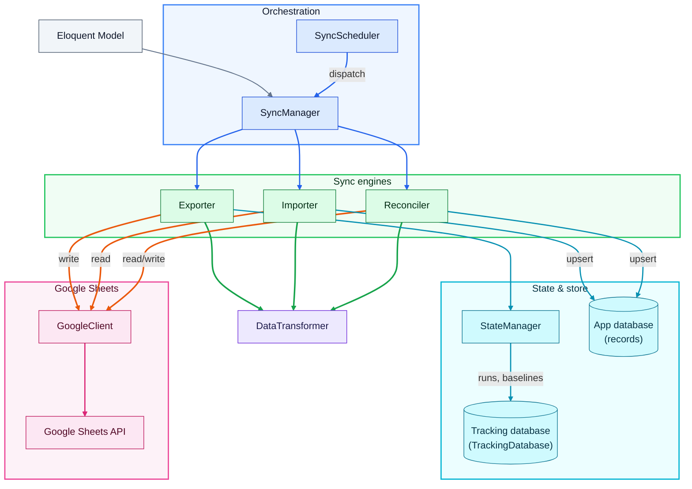
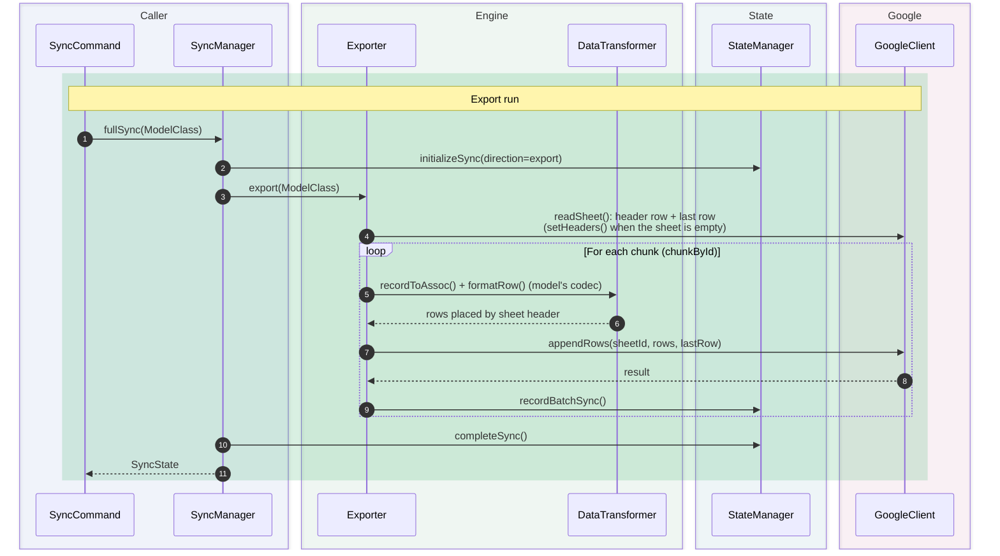
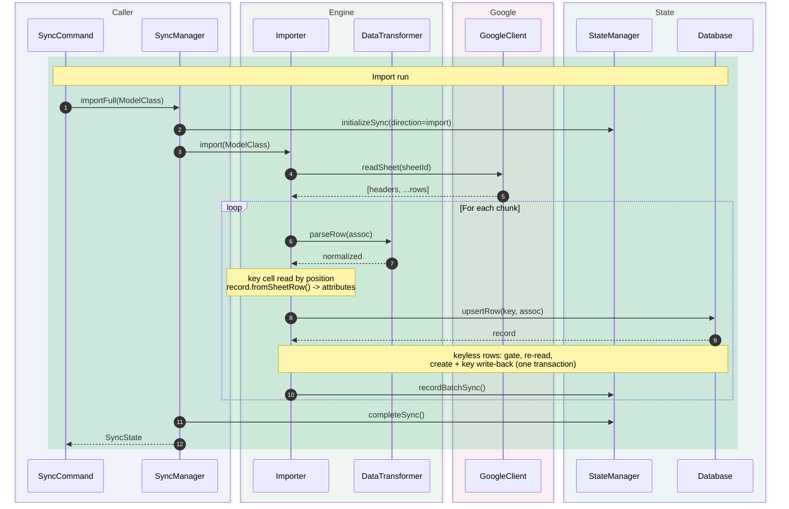
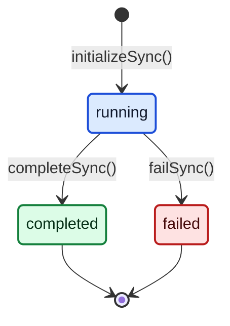

# Component Overview

***How SyncroSheet is put together — the components, how data flows DB ⇄ Sheet, and the run lifecycle.***

**Last updated:** 2026-10-18 · verified against [`7f9a6dc`](https://github.com/ultra-bugs/syncro-sheet/commit/7f9a6dc442f65ee59193c57a5a722fa2012ab8d5)

> [!NOTE]
> Two axes are easy to confuse: **direction** (`export` / `import` / `bidirectional`) is *which way data flows*, while **write_mode** (`append` / `replace`) is *how export writes the sheet*. `SheetSyncable` is a **bidirectional** model (`SheetExportable` + `SheetImportable`). `StateManager` owns run history (`SyncState` / `SyncEntry`) **and** the reconcile baseline (`SyncSnapshot`).

- Namespace: `Zuko\SyncroSheet` · Composer: `zuko/syncro-sheet` · Provider: `Zuko\SyncroSheet\LaravelSyncroSheetProvider`
- Worked example (a real model on the live API, every component exercised): [real-run example](examples/real-run/README.md)

## Color legend

One concept = one color, used consistently across every diagram below.

| Color | Node / area | Concept |
|---|---|---|
| blue | SyncManager, SyncScheduler | Orchestrator / dispatcher |
| green | Exporter, Importer, Reconciler | Sync engines |
| cyan | StateManager, Database | State / store |
| purple | DataTransformer | Value codec |
| orange | — | Sheet I/O flow (read / write) |
| pink | GoogleClient, Google Sheets API | External boundary |
| slate | Eloquent Model | Input / trigger |

## Table of Contents

- [Glossary](#glossary)
- [Component List & Summary](#component-list--summary)
- [CLI & Jobs → component](#cli--jobs--component)
- [Component Interactions](#component-interactions)
- [Flow](#flow)
- [Lifecycle](#lifecycle)
- [Caveats / to review](#caveats--to-review)

# Glossary

Single source of truth for the vocabulary — read this first to avoid mixing up
the overlapping-sounding terms.

| Term | Kind | Role | Don't confuse with |
|---|---|---|---|
| **direction** | config / `sync_states.direction` | Data flow: `export` (DB→Sheet), `import` (Sheet→DB), `bidirectional` | `write_mode` |
| **write_mode** | config `export.write_mode` / `sync_states.write_mode` | HOW export writes the sheet: `append` or `replace`. Export-only | `direction` |
| **sync_type** | `sync_states.sync_type` | Scope of a run: `full` or `partial` | direction / write_mode |
| **source_of_truth** | config / model `getSyncSourceOfTruth()` | Winning side on a reconcile conflict: `db` or `sheet` | — |
| **SheetBound** | interface | Base: `getSheetIdentifier()`, `getSheetName()` | — |
| **SheetExportable** | interface | Model can export (`toSheetRow()`) | the old `SheetSyncable` |
| **SheetImportable** | interface | Model can import (`getSheetKeyColumn()`, `getSheetKeyColumnIndex()`, `fromSheetRow()`) | — |
| **SheetSyncable** | interface | **Bidirectional** model — extends both of the above | old meaning (= export) |
| **Exporter** | service | Engine DB→Sheet (chunked write) | Importer |
| **Importer** | service | Engine Sheet→DB (chunked upsert by PK) | Exporter |
| **Reconciler** | service | Two-way engine: `decide()` (read + diff baseline) + `apply()` | Exporter/Importer |
| **DataTransformer** | service | Value codec both ways + `canonicalHash` (no state, no I/O) | an orchestrator |
| **StateManager** | service | Owns ALL tracking tables: SyncState + SyncEntry + SyncSnapshot | — |
| **SyncState** | model | One run: direction, sync_type, write_mode, status, counters | SyncEntry |
| **SyncEntry** | model | Per-record result within a run (audit/history) | SyncSnapshot |
| **SyncSnapshot** | model | Current content-hash baseline per record (reconcile) | a per-run log |
| **GoogleClient** | service | revolution wrapper: read/append/updateRows/headers/clear + rate limit | — |
| **SyncManager** | service | Orchestrator/entry: fullSync/partialSync, importFull/importPartial, sync | SyncScheduler |
| **TrackingDatabase** | service | Resolves (in boot) where the tracking tables live: configured connection, own SQLite file, or app default (+ warning) | StateManager |
| **canImportSheetRow / shouldImportSheetRow** | trait method / model hook | May a sheet row without a key become a record? | fromSheetRow() |
| **getSheetTransformer / sheetTransformer** | trait method / model hook | The model's DataTransformer for writes, reads and hashes | the shared DataTransformer |

# Component List & Summary

### 1. Core Components

#### `SyncManager` (Main Orchestrator)
- Primary entry point for sync operations
- Coordinates between all other components
- Handles high-level error management
- Ensures proper sync state tracking

#### Sync Contracts (Interfaces)
- `SheetBound` — shared base: `getSheetIdentifier()`, `getSheetName()`
- `SheetExportable extends SheetBound` — export (DB → Sheet): adds `toSheetRow()`
- `SheetImportable extends SheetBound` — import (Sheet → DB): adds
  `getSheetKeyColumn()`, `getSheetKeyColumnIndex()` + `fromSheetRow()`. The
  `InteractsWithSheet` trait ships sensible defaults for all three.
- `SheetSyncable extends SheetExportable, SheetImportable` — **bidirectional**
  marker; a two-way model implements this one interface.
```php
interface SheetBound
{
    public function getSheetIdentifier(): string;    // Google Sheet ID
    public function getSheetName(): string;          // Sheet name
}

interface SheetExportable extends SheetBound
{
    public function toSheetRow(): array;             // DB -> Sheet row
    // Optional: getBatchSize(): int (defaults to config), defaultSheetHeaders(): array
}

interface SheetImportable extends SheetBound
{
    public function getSheetKeyColumn(): string;     // attribute / header name of the PK
    public function getSheetKeyColumnIndex(): int;   // 0-based column of the PK cell (header may be blank)
    public function fromSheetRow(array $row): array; // Sheet row -> model attributes
}

interface SheetSyncable extends SheetExportable, SheetImportable {}  // bidirectional
```

Optional model methods — detected with `method_exists()`, so a model only
declares what it needs:

| Method | Used by | Effect |
|---|---|---|
| `getBatchSize(): int` | Exporter, Importer | chunk size (default `defaults.batch_size`) |
| `defaultSheetHeaders(): array` | all engines | names the positions of a positional `toSheetRow()` (`''` = not ours) |
| `syncReadOnlyColumns(): array` | Reconciler | written on append only; never overwritten; out of the hash |
| `syncHashIgnore(): array` | Reconciler | columns left out of change detection (default `reconcile.hash_ignore`) |
| `getSyncSourceOfTruth(): string` | Reconciler | conflict winner `db` / `sheet` (default `defaults.source_of_truth`) |
| `shouldImportSheetRow(array $row): bool` | Importer, Reconciler (via `canImportSheetRow()`) | may a row without a key become a record |
| `sheetTransformer(): DataTransformer\|string` | all engines (via `getSheetTransformer()`) | the model's value codec |

### 2. Data Processing Components

#### `Exporter` (DB → Sheet)
- Export engine (formerly `BatchProcessor`)
- Manages chunked data processing
- Uses Laravel's lazy loading for memory efficiency
- Reports progress to state manager
- Handles chunk-level errors
- Public API: `export()` (full), `exportPartial()` (specific record IDs)

#### `Importer` (Sheet → DB)
- Import engine, symmetric counterpart of `Exporter`
- Reads the sheet via `GoogleClient::readSheet()`, matches rows to records by
  the key cell at `getSheetKeyColumnIndex()` (read by position — the header may
  be blank)
- Upsert semantics: `upsertRow()` per row (finds the record, runs
  `fromSheetRow()` on it, keeps the sheet's key on create even when guarded,
  moves the PostgreSQL sequence past it; soft-deleted records left alone) or
  `Model::upsert()` batch (opt-in via `syncro-sheet.defaults.import.use_batch_upsert`);
  never deletes
- Rows without a key: `createFromSheetRows()` — gate `canImportSheetRow()`,
  re-read (`GoogleClient::readRows()`), create + write the key back in one DB
  transaction
- Public API: `import()` (full), `importPartial()` (specific record IDs),
  `importRows()` (already-read rows, queue driver)

#### `Reconciler` (Sheet ⇄ DB)
- Two-way reconcile engine for bidirectional models (`SheetSyncable`)
- Matches by primary key; detects which side changed vs. a content-hash
  **baseline**; resolves genuine conflicts by a fixed source-of-truth
  (`getSyncSourceOfTruth()` / `config('syncro-sheet.defaults.source_of_truth')`)
- Plan actions: `export` (update in place / append), `import` (upsert), `create`
  (sheet row without a key → record + key written back)
- Writes DB→sheet via sparse `GoogleClient::updateRows()` (one
  `values.batchUpdate`, read-only columns skipped) + `appendRows()` for new
  rows, and sheet→DB via `Importer::upsertRow()`; never deletes
- Public API: `reconcile()` (driven by `SyncManager::sync()`), `decide()` +
  `applyChunk()` (the queue driver runs them separately)

#### `DataTransformer` (value codec, per model)
- Resolved per model: `DataTransformer::forModel($model)` → the model's
  `getSheetTransformer()` (hook `sheetTransformer()`), else the shared one.
  Extension points: `transformRecord()`, `formatValue()`, `parseValue()`.
- The single place that converts values **both ways**: model → cell on export
  (`transformBatch`/`formatRow`/`formatValue`) and cell → model on import (`parseRow`)
- `canonicalHash()` builds a normalized content hash so the DB side and the sheet
  side compare on equal footing (reconcile change-detection)
- Holds no state and does no I/O — the engines call it

### 3. State Management Components

#### `StateManager`
- Owns **all** tracking tables and is the only service that writes them:
  - `SyncState` — status/history of each run
  - `SyncEntry` — per-record result within a run
  - `SyncSnapshot` — current content-hash baseline per record (reconcile)
- Run lifecycle: `initializeSync()` / `recordBatchSync()` / `completeSync()` / `failSync()`
- Reconcile baseline: `baselineFor()` loads the map, `storeSnapshots()` upserts it
  (previously a separate `SnapshotManager`, now merged here)

#### `SyncState` (Model)
```php
// Used for tracking sync state of one sync call
class SyncState extends Model
{
    protected $fillable = [
        'model_class',      // Model class name
        'sync_type',        // 'full' or 'partial'
        'direction',        // 'export', 'import' or 'bidirectional'
        'write_mode',       // 'append' or 'replace' (export write strategy)
        'status',           // 'running', 'completed', 'failed'
        'started_at',
        'completed_at',
        'total_processed',
        'last_processed_id',
    ];
}

// Used for tracking individual records
class SyncEntry extends Model
{
    protected $fillable = [
        'model_class',
        'record_id',
        'synced_at',
        'sync_state_id',    // Reference to parent SyncState
        'sync_type',        // 'full' or 'partial'
        'status'            // 'success' or 'failed'
    ];

    protected $casts = [
        'synced_at' => 'datetime'
    ];
}
```

### 4. Google Sheets Integration

#### `GoogleClient` (Wrapper around revolution/laravel-google-sheets)
- Manages Google Sheets connections and authentication (service-account file
  by absolute or base-relative path)
- Every call is scoped to a **quoted** sheet name with a fresh range (the
  underlying client is shared and stateful)
- `readSheet()` reads typed values (`UNFORMATTED_VALUE`, dates as displayed);
  `readRows()` re-reads given rows in one `values.batchGet`
- `appendRows()` appends positional rows anchored on `A{lastRow+1}`;
  `updateRows()` writes sparse cell maps of many rows in one
  `values.batchUpdate` (adjacent columns grouped into one range)
- Client-side throttle (`sheets.rate_limit`, default 60/min) and retry with
  exponential backoff + jitter on 429 / 5xx (`sheets.retry`)

### 5. Logging & Monitoring

#### `SyncLogger`
- Dedicated logging channel
- Structured log format
- Performance logging
- Error tracking

#### `SyncEvent`
```php
class SyncEvent // dispatched by NotificationManager
{
    const SYNC_STARTED = 'sync.started';
    const CHUNK_PROCESSED = 'sync.chunk_processed';
    const SYNC_COMPLETED = 'sync.completed';
    const SYNC_FAILED = 'sync.failed';
}
```

### 6. Configuration

#### Package Config (`syncro-sheet.php`)

Top-level keys (defaults in [`config/syncro-sheet.php`](../config/syncro-sheet.php)):

| Key | Holds |
|---|---|
| `defaults` | `batch_size` 100, `direction`, `source_of_truth`, `timeout`, `retries`, `export.write_mode`, `import.use_batch_upsert`, `reconcile.hash_ignore` |
| `database` | `connection` / `sqlite_database` — where the tracking tables live (`TrackingDatabase`) |
| `logging` | `channel` (`sheet-sync`), `level`, `separate_files` |
| `sheets` | `read` render options, `cache_ttl`, `rate_limit` (60 / 60 s), `retry` (5 times, 2 000 ms base) |
| `notifications` | channels, `notify_on` |
| `scheduler` | `enabled`, `driver` (`sync` / `queue`), `frequency`, `models`, `queue` |

### 7. Scheduling / Trigger Components

#### `SyncScheduler` (dispatcher)
- Reads `scheduler.models` (each as a direction) and hands each off to the
  configured driver. Driven by the `sheet:scheduled-sync` command, which the
  provider registers on Laravel's scheduler when `scheduler.enabled`.

#### `SyncDriver` (interface) + drivers
- `InlineDriver` (`driver=sync`) — runs the sync in-process via `SyncManager`.
- `QueueDriver` (`driver=queue`) — fans out to queued jobs; for bidirectional it
  runs `Reconciler::decide()` centrally then dispatches apply jobs.
- (`parallel`, a fork-based consumer, is planned for a later stage.)

#### Jobs
- `PartialSyncJob` / `PartialImportJob` — export / import a chunk of record IDs.
- `ImportBatchJob` — upsert a chunk of already-read sheet rows (no re-read).
- `ReconcileApplyJob` — apply a chunk of reconcile decisions from `decide()`.

#### `TrackingDatabase`
- In the provider's `boot()`: `syncro-sheet.database.connection` when set;
  else connection `syncro-sheet` = own SQLite file when `pdo_sqlite` is
  loaded (schema created on first boot, migrated after each `migrate` and by
  `syncro-sheet:migrate`); else the app default, with a warning on the package
  log and the app's default channel.
- Tracking models (`UsesTrackingConnection`), `StateManager`, `ErrorHandler`
  and the package migrations use the resolved connection; no query joins a
  model table with a tracking table.

# CLI & Jobs → component

Surfaces that trigger a sync and the component each one drives.

| Surface | File | Drives |
|---|---|---|
| `sheet:sync {model} --direction` | [@SheetSyncCommand.php](../src/Console/Commands/SheetSyncCommand.php) | `SyncManager::fullSync` / `importFull` / `sync` |
| `sheet:scheduled-sync` | [@ScheduledSyncCommand.php](../src/Console/Commands/ScheduledSyncCommand.php) | `SyncScheduler::run` → driver |
| `syncro-sheet:migrate` | [@MigrateTrackingCommand.php](../src/Console/Commands/MigrateTrackingCommand.php) | `TrackingDatabase::migrate` (own SQLite file) |
| `PartialSyncJob` | [@PartialSyncJob.php](../src/Jobs/PartialSyncJob.php) | `SyncManager::partialSync` (export chunk) |
| `PartialImportJob` | [@PartialImportJob.php](../src/Jobs/PartialImportJob.php) | `SyncManager::importPartial` (import chunk) |
| `ImportBatchJob` | [@ImportBatchJob.php](../src/Jobs/ImportBatchJob.php) | `Importer::importRows` (queue import) |
| `ReconcileApplyJob` | [@ReconcileApplyJob.php](../src/Jobs/ReconcileApplyJob.php) | `Reconciler::applyChunk` (queue reconcile) |

# Component Interactions




# Flow:

## Export flow (DB → Sheet)



## Import flow (Sheet → DB)



# Lifecycle

A `SyncState` row tracks one run. The code starts it at `running`
([@StateManager.php](../src/Services/StateManager.php)); the `pending` enum value
exists in the schema but is currently unused.



- _blue = running · green = completed · red = failed._

# Caveats / to review

| Marker | Issue | Where |
|---|---|---|
| **REVIEW** | Queue export fans out *all* primary keys each run; the "not synced in 7 days" filter is not applied on this path yet. | [@QueueDriver.php](../src/Services/Drivers/QueueDriver.php) |
| **REVIEW** | Queue reconcile apply jobs do not open a per-chunk `SyncState`, so that path has no per-run audit row. | [@ReconcileApplyJob.php](../src/Jobs/ReconcileApplyJob.php) |
| **NOTE** | Worked example: a real model synced both ways on the live API, 17 scenarios, results per round, pitfalls | [@real-run example](examples/real-run/README.md) |
| **NOTE** | Model hooks (import gate, per-model transformer) + tracking connection | [@20261018_model-hooks-and-tracking-connection.md](agent-plans/20261018_model-hooks-and-tracking-connection.md) |
| **NOTE** | Key by column index; rows without a key are created and get their key written back | [@20261018_sheet-key-column-index.md](agent-plans/20261018_sheet-key-column-index.md) |
| **NOTE** | Real-run defects and their fixes (positional rows, append anchoring, typed values, guarded keys, soft deletes, read-only columns) | [@20261018_real-run-fixes.md](agent-plans/20261018_real-run-fixes.md) |
| **REVIEW** | Only numeric primary keys are supported — `sync_entries.record_id` / `sync_snapshots.record_id` are `bigInteger`. | [@create_sync_entries_table.php](../database/migrations/2024_06_01_000001_create_sync_entries_table.php) |

- When docs drift from code, log it centrally at `docs/need-reviews/code-doc-missmatch.md` (repo root) and link here instead of duplicating.
