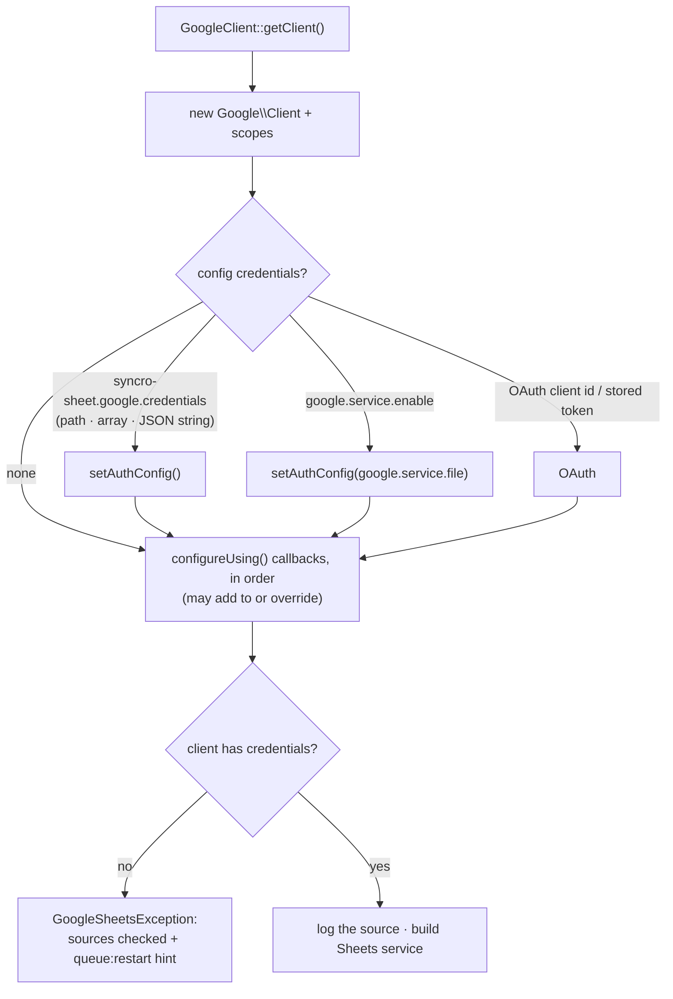

# `configureUsing()`: configure the Google client in code

**Date:** 2026-10-18 · **Follows:** [20261018_production-tab-rehearsal.md](20261018_production-tab-rehearsal.md)

## 1. Why

On the Fitly host the queue worker kept failing with `No Google credentials
configured`, while `tinker` showed `syncro-sheet.google.credentials` set. Config
is the only way to hand credentials to the package, and config is easy to get
wrong across processes:

- a running queue worker keeps the config it booted with until `queue:restart`;
- `config:cache` freezes `env()`;
- revolution reads `google.service.*`, so keys such as `google.credentials`
  or `google.service_account.enabled` are silently ignored;
- a JSON blob in an env var is read as a file path.

The host app (or one of its modules) knows where its service account lives.
It should be able to say so in code, in a service provider, the way Laravel
packages expose `…Using()` hooks.

## 2. Plan

1. `SyncManager::configureUsing(Closure $callback)` (static, so a provider
   need not resolve the manager) and `SyncroSheet::configureUsing()` through
   the facade. The callback receives the `Google\Client` the package builds,
   after the config-based credentials, and may set or override anything
   (credentials, subject, HTTP client).
2. Callbacks live in a container singleton (`ClientConfigurators`): they
   survive a re-resolved `GoogleClient`, never leak across application
   instances (tests), and a callback added after a client was built makes the
   next call rebuild it.
3. The config chain no longer throws when it finds nothing. Once the callbacks
   have run, a client with no credentials at all (no service-account key, no
   OAuth client id, no token, no ADC) fails with the sources it checked, and a
   reminder that a running worker needs `queue:restart`.
4. `syncro-sheet.google.credentials` also accepts the JSON itself (env vars
   in containers).
5. The source used is logged once per client (`Google client: credentials
   from …`): a worker's log says what that process saw.
6. Fitly/BetMate switches from setting config at boot to a callback, which
   still defers to credentials the app configured itself.

## 3. Results

- Tests 72/72 (`ConfigureUsingTest`, 6 new):
  - a callback provides the credentials;
  - the facade registers callbacks too;
  - callbacks run after the config and may override it;
  - a callback added later rebuilds the client;
  - no credentials from anywhere fails with the sources checked;
  - the setting takes the JSON itself.
- Fitly/BetMate registers its callback in the provider's `boot()`.
  `php artisan sheet:sync … --direction=both --dry-run` with no
  `GOOGLE_SERVICE_*` and no `SYNCRO_SHEET_GOOGLE_CREDENTIALS` reads the sheet;
  the package log says `Google client: credentials from configureUsing()`.
- Code `2eb4579`. Real run, round 12 (no `GOOGLE_SERVICE_*`, no `SYNCRO_SHEET_GOOGLE_CREDENTIALS`: credentials only through the callback): 48 checks, 0 failed.
