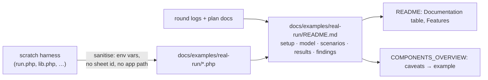

# Docs refresh + the real run as a worked example

**Date:** 2026-10-18 · **Follows:** [20261018_model-hooks-and-tracking-connection.md](20261018_model-hooks-and-tracking-connection.md)

## 1. Why

- The real run that verified the bidirectional engine (Fitly / BetMate
  `BetTransaction`, live Google Sheets API, PostgreSQL 18 on PGlite) exists
  only as a scratch harness and a few result tables spread over three plan
  docs. It is the most complete usage example the package has: a positional
  model, a key in a column with no header, formulas, rows typed on the sheet,
  conflicts, the queue driver, 3 782 records.
- The README and the component overview drifted from the code over the last
  rounds (verified-against commit, install steps, rate-limit defaults, event
  names, export/import flow calls, a documented `getLastSync()` that does not
  exist).

## 2. Plan

1. Ship the harness under `docs/examples/real-run/` (not autoloaded, not run
   by CI):
   - spreadsheet id, service-account file, app path, tab names from
     environment variables; state file in the temp dir;
   - PGlite patch applies to every `pgsql` connection, only when asked;
   - the app-specific legacy check (S15) is left out.
2. Walkthrough `docs/examples/real-run/README.md`: environment, sheet shape,
   the model contract, harness principles, scenario catalogue, results per
   round, defects found → fixes, normalisation to expect, how to adapt it.
3. README: verified-against commit, Documentation table, Features, install
   (migrations are not published), requirements (`pdo_sqlite`), rate-limit
   defaults, error-handling imports, `getLastSync()` → `StateManager`.
4. Component overview: contracts and optional hooks, Importer / Reconciler /
   GoogleClient behaviour, config defaults, `SyncEvent` names, flow diagrams
   (`appendRows`, `upsertRow`), tracking DB in the interaction graph.
5. Code drift fixed on the way: the facade's `@method getLastSync()` (no such
   method) removed; duplicated docblock in `Exporter` merged.
6. Re-run the shipped harness as published (env vars) to prove it runs.

## 3. Results

- Shipped harness re-run exactly as published (env vars, PGlite, live API,
  tracking on the package's SQLite file): 48 checks, 0 failed, exit 0. Scale
  3 782 records: initial 3.8 s, no-op 1.6 s, single edit 1.6 s.
- Mermaid: all 10 diagrams in the package docs parse (mermaid 11.4.1). One
  pre-existing error fixed (`;` inside a sequence message in
  `20261018_sheet-key-column-index.md`). Relative links and anchors: 0
  problems.
