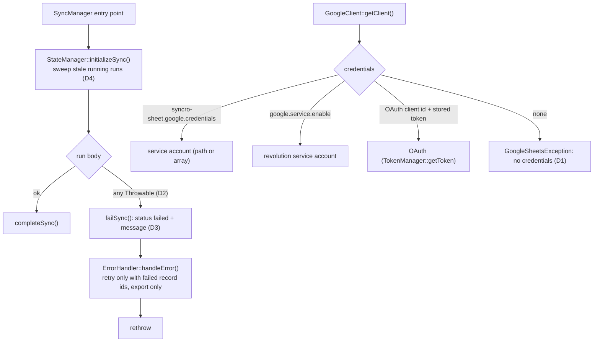

# Failed runs stuck at `running` + package-scoped credentials

**Date:** 2026-10-18 · **Follows:** [20261018_docs-refresh-real-run-example.md](20261018_docs-refresh-real-run-example.md)

## 1. Why

Reported from the Fitly AdminCP: a two-way sync of `BetTransaction` was queued,
the run row stayed `running` with 0 records, and the `sheet-sync` log held only
`Starting bidirectional sync …`. The app log had the cause:

```
Error: Call to undefined method Zuko\SyncroSheet\Services\TokenManager::getToken()
  GoogleClient.php:142 setupOAuth() ← getClient() ← readSheet() ← Reconciler::decide()
```

Three defects line up behind it:

| # | Defect | Effect |
|---|---|---|
| D1 | `GoogleClient` calls `TokenManager::getToken()`, which does not exist. Reached whenever `google.service.enable` is false (OAuth branch). | `\Error` on the first API call of any run without `GOOGLE_SERVICE_ENABLED=true`. |
| D2 | `SyncManager` catches `\Exception` only. | An `\Error` (D1, a `TypeError`, …) skips the error path entirely: no failed state, no error log on the package channel. |
| D3 | `fullSync()` / `importFull()` / `sync()` route failures to `ErrorHandler::handleError()`, which never marks the state failed; its retry branch (always taken, since it counts failed states that never exist) queues a `PartialSyncJob` export with an empty id list, whatever the direction. | Every failed full export, full import or two-way run stays `running` forever, and queues a meaningless retry. |
| D4 | Nothing ends a run whose worker died (timeout kill, OOM, deploy). | Same symptom as D2/D3 for crashes outside PHP's control. |

Separately, the package can only authenticate through revolution's global
`google.service.*` (`GOOGLE_SERVICE_ENABLED`, `GOOGLE_SERVICE_ACCOUNT_JSON_LOCATION`),
so a host module that owns its own service account (BetMate) cannot hand it to
the package without switching the whole app's Google client.

## 2. Plan



1. **D1** — `TokenManager::getToken(): ?array` returns the stored OAuth token.
   `setupOAuth()` throws `GoogleSheetsException` naming the settings to fill
   when there is neither an OAuth client id nor a stored token.
2. **Credentials** — new `syncro-sheet.google.credentials`
   (`SYNCRO_SHEET_GOOGLE_CREDENTIALS`): a service-account JSON path or the
   decoded array, used by the package's client only. Null keeps today's
   behaviour (`google.service.*`, then OAuth).
3. **D2/D3** — every `SyncManager` entry point catches `\Throwable`, marks the
   state failed (`failSync()`), then hands the error to `ErrorHandler`
   (signature widened to `\Throwable`; notifications too). `ErrorHandler`
   schedules a `PartialSyncJob` only when there are failed record ids and the
   failed run was an export; otherwise it goes straight to the final-failure
   notification.
4. **D4** — `initializeSync()` first marks the model's `running` runs older
   than `defaults.timeout` (+60 s grace) as failed:
   `Abandoned: no result after N s (worker stopped?)`.
5. **Tests** — no credentials → failed state with the message, no `\Error`;
   an `\Error` inside the run → failed state; a failed two-way run queues no
   `PartialSyncJob`; a stale running run is ended by the next run, a fresh one
   is left alone; `syncro-sheet.google.credentials` wins over `google.service.*`.
6. **Docs** — README (config, troubleshooting), COMPONENTS_OVERVIEW (config
   table, error flow).

## 3. Out of scope

- The Laravel branch of `GoogleClient::getClient()` (`Google\Client` bound in
  the container) is kept as is; revolution does not bind that class.
- Auto-creating a missing tab.

## 4. Results

Code: `5db9bd7`.

- Tests: 58/58 (`tests/Feature/FailedRunTest.php`, 6 new). All 6 fail on the
  previous code (4 errors, 2 failures), so each pins one defect.
- While wiring the error path, two more defects turned up in it and are fixed
  in the same commit: `Sync*Notification` type-hinted `SyncState` without
  importing it (a `TypeError` as soon as a failure notification is built), and
  `BaseNotification` had no `toMail()` / `toSlack()`, so a notification could not be sent.
- Real run, round 9 (BetMate, `GOOGLE_SERVICE_ENABLED=false`, credentials from
  the module through `syncro-sheet.google.credentials`): 48 checks, 0 failed.
- The admin-panel job (`RunTransactionSheetSyncJob`) was driven three times on the test tab:

| Case | Job | Run |
|---|---|---|
| module credentials, a run left `running` 12 min earlier | ok | completed; the old run failed `Abandoned: no result after 660 s (worker stopped?)` |
| no two-way tab | `SyncException` | failed, `No two-way sync tab configured: …` |
| no credentials at all | `GoogleSheetsException` | failed, `… No Google credentials configured: …` |
