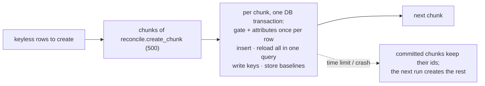

# First run at scale: fewer queries, resumable creates

**Date:** 2026-10-18 · **Follows:** [20261018_configure-using.md](20261018_configure-using.md)

## 1. Why

On the Fitly host the first two-way run of `Thu chi` (4 102 rows to create,
remote PostgreSQL) hit the 600 s job timeout inside `applyCreates()`. Nothing
was written: the run died before the DB transaction committed and before any
sheet write.

Profile of the same run on the rehearsal copy (PGlite, with the app's per-run
account cache):

| Query | Count | From |
|---|---|---|
| `insert` records | 4 102 | one per created row |
| `select` records | 4 104 | `fresh()` per created record |
| `select` relations | ~8 800 | the model's `$with` eager loads, again per `fresh()` |
| account lookups | ~300 | the app's gate / `fromSheetRow()` |
| **total** | **17 009** | |

Each query is a network round trip on a remote database. The host also lacked
the app's account cache, so it was closer to 44k queries. And the whole create
phase is one transaction: a run that cannot finish in time makes no progress
at all.

## 2. Plan

1. `applyCreates()` reloads the created records in **one** query (eager loads
   included) instead of `fresh()` per record.
2. `Importer::createFromSheetRows()` computes each row's attributes once,
   shared by the gate and the insert. Before, `fromSheetRow()` ran twice per
   row there, plus once in `decide()`.
3. Creates run in chunks of `defaults.reconcile.create_chunk` (500). Each
   chunk does its insert, its key write-back and its baseline in one
   transaction, so a run cut short keeps the chunks it finished. The next run
   sees those rows keyed and in sync, and creates the rest.
4. Tracking inserts (`sync_entries`, `sync_snapshots`) are written in batches
   of 500 rows, under SQLite's bound-parameter limit (32 766 by default; 4 102
   entries × 8 columns is over it).
5. `StateManager::failRunningRuns()` lets a host's queue job end its run as
   soon as the worker times it out, instead of waiting for the abandoned-run
   sweep.
6. `defaults.timeout` reads `SYNCRO_SHEET_TIMEOUT`.

## 3. Results

- Tests 76/76 (`FirstRunAtScaleTest`, 4 new: one reload per chunk, finished
  chunks kept when a later chunk fails, running runs ended now, baselines in
  batches). All 4 fail on the previous code.
- Rehearsal, first run on a copy of the production tab (4 102 created, PGlite):

| | Before | After |
|---|---|---|
| queries | 17 009 | 4 743 (4 102 inserts, ~600 account lookups, 11 reloads, 18 tracking writes) |
| time | 30.2 s | 20.4 s |
| cells changed on the copy | 4 102, all X | 4 102, all X |
| second run | 0 | 0 |

- The remaining cost is one insert per record, which keeps model events and
  casts. On a remote database the first run takes about 4 700 round trips; a
  run cut short keeps its finished chunks.
- Fitly/BetMate: `RunTransactionSheetSyncJob::failed()` ends the run on a
  worker timeout only. A `MaxAttemptsExceededException` is a re-reserved copy,
  and the original may still be running.
- Code `92ffcf4`. Real run, round 13: 48 checks, 0 failed (S14 scale 3 782 records: initial 3.4 s, no-op 1.7 s, one edit 1.8 s).
