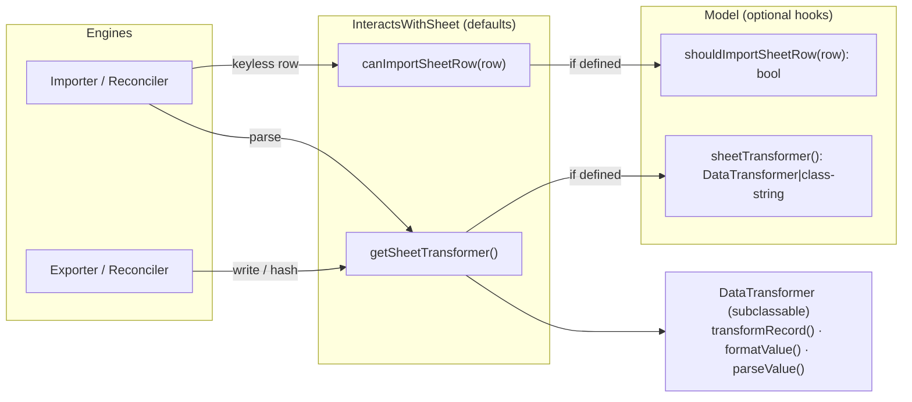
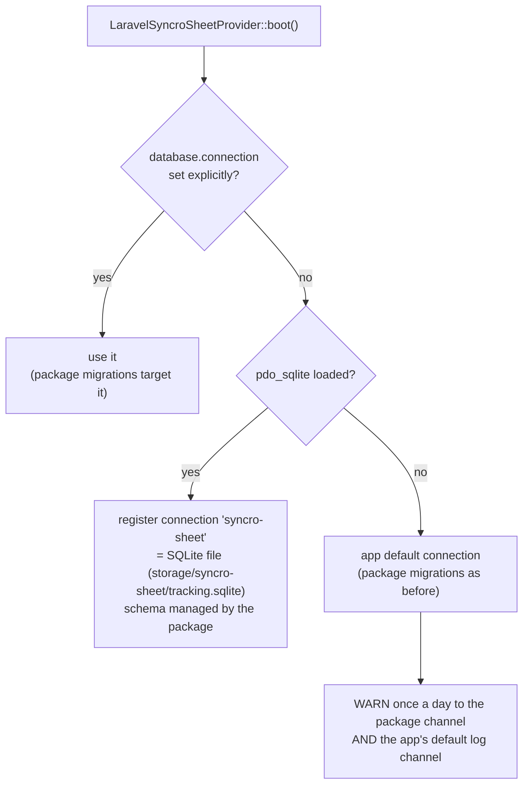

# Model hooks (import gate, per-model transformer) + tracking connection

**Date:** 2026-10-18 · **Follows:** [20261018_sheet-key-column-index.md](20261018_sheet-key-column-index.md)

## 1. Why

- **Rows without a key.** Whether a sheet row may become a record is a model
  decision; today it is inferred from `fromSheetRow()` returning `[]`, which
  mixes "map the row" with "is it a record". The model gets an explicit hook,
  called through `InteractsWithSheet`.
- **How a record is written.** The README's "Custom Data Transformation"
  (`ProductTransformer extends DataTransformer`, overriding `transformRecord()`)
  was never wired: `transformRecord()` is private and every engine uses the one
  shared `DataTransformer`. The model gets a hook that names its transformer,
  and every write (export, in-place update, append, key write-back), hash and
  parse goes through it.
- **Tracking tables** (`sync_states`, `sync_entries`, `sync_snapshots`) always
  live on the app's default connection. Option B (chosen): a dedicated
  SQLite file by default, the app default only when `pdo_sqlite` is missing.

## 2. Hooks

| Engine-facing (trait default) | Model hook (optional) | Default when absent |
|---|---|---|
| `canImportSheetRow(array $row): bool` | `shouldImportSheetRow(array $row): bool` | `true` (a row still needs non-empty `fromSheetRow()` to be created) |
| `getSheetTransformer(): DataTransformer` | `sheetTransformer(): DataTransformer\|string` | the shared `DataTransformer` |

- Engines resolve once per run: `DataTransformer::forModel($model)` → the
  model's transformer (or the shared one when the model has no trait).
- `DataTransformer` extension points become `protected`: `transformRecord()`
  (record → sheet row, default `toSheetRow()`), `formatValue()` (cell value on
  write and in the hash), `parseValue()` (cell value on read). Since the same
  transformer formats both sides of the content hash, a custom format cannot
  cause flip-flopping.
- `fromSheetRow()` returning `[]` keeps meaning "nothing to create/update".

## 3. Tracking connection

Decided in the provider's `boot()`:

- `syncro-sheet.database.connection` (`SYNCRO_SHEET_DB_CONNECTION`) overrides
  the choice; `syncro-sheet.database.sqlite_database`
  (`SYNCRO_SHEET_SQLITE_DATABASE`) moves the SQLite file.
- The dedicated SQLite file keeps its own `migrations` table: the package
  creates the file and runs its migrations on first boot (under a file lock),
  again after every `php artisan migrate`, and on `syncro-sheet:migrate`.
  The app's `migrations` table is not used for it, so an install whose
  tracking tables used to live in the app database still gets them created.
  (The old tables stay where they were; they are no longer read.)
- SQLite tuned for concurrent queue workers: `journal_mode=wal`,
  `busy_timeout`, foreign keys on.
- `SyncState` / `SyncEntry` / `SyncSnapshot` and `StateManager` use the
  resolved connection.
- No SQL may join a model table with a tracking table:
  - `Exporter` full-sync "not synced in the last 7 days" filter: same
    connection → `whereNotExists` subquery (as today); different connection →
    the recent ids are loaded from the tracking connection and skipped per
    chunk in PHP.
  - Fitly `BetTransactionResource` "Synced with sheet" filter → ids from the
    tracking connection (`whereIn` / `whereNotIn`), not `has()`.

## 4. Steps

1. Trait hooks + `DataTransformer::forModel()`; protected extension points.
2. Engines use the per-model transformer; keyless gate via `canImportSheetRow()`.
3. Tracking connection resolved in `boot()` (SQLite when available, else app
   default + warning on both channels); self-managed SQLite schema; models,
   `StateManager`, migrations, Exporter filter.
4. Tests: custom transformer used on every write path + stable hash; gate hook;
   tracking tables on a second SQLite connection.
5. Fitly: `BetTransaction` uses the trait, `shouldImportSheetRow()` replaces
   the `[]` convention; Synced-with-sheet filter without cross-connection SQL;
   real run with the tracking tables on a SQLite file.

## 5. Results

- Package suite 52/52 (hooks: every write path through the model transformer,
  stable hash, import gate; tracking: explicit / own SQLite / fallback with the
  two-channel warning once; cross-connection 7-day filter).
- Found on the way: the export "not synced in 7 days" subquery compared
  `record_id` with the unqualified `id`, i.e. `sync_entries.id` — wrong rows
  filtered, records re-exported. Fixed (qualified key) and covered.
- Real run (Fitly, live Sheets API, records on PostgreSQL, tracking on the own
  SQLite file): 49 checks, 1 failed (S15, BetMate's legacy push path); scale
  3 782 records: initial 4.1 s, no-op 1.7 s. Explicit `pgsql` tracking: 18/18.
