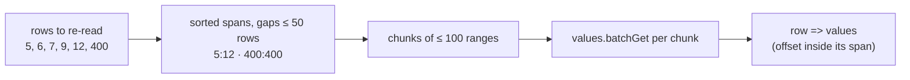

# Rehearsal on a copy of a production ledger tab

**Date:** 2026-10-18 · **Follows:** [20261018_failed-runs-and-credentials.md](20261018_failed-runs-and-credentials.md)

## 1. Why

Fitly decided to run the two-way sync of `BetTransaction` on its production
ledger tab (`Thu chi`, ~5.5k rows, 4 514 transactions, no ids yet), the
database being rebuilt from the sheet. Before touching that tab, the first
run is rehearsed on an exact copy (`duplicateSheet`: values, formulas,
formatting) with a throwaway database.

The rehearsal's first run failed at the write-back step:

```
GoogleSheetsException: Failed to read rows from Google Sheets: … Error 413 (Request Entity Too Large)
```

| # | Defect | Effect |
|---|---|---|
| D5 | `GoogleClient::readRows()` re-reads every created row in **one** `values.batchGet` GET, one `N:N` range per row. | With thousands of rows the URL is too long (413). Every first run on a real-sized tab fails; S16 (37 rows) never hit it. |

## 2. Plan



1. **D5** — `readRows()` merges the sorted row numbers into spans (a gap of
   at most 50 rows is read and discarded), sends at most 100 spans per
   `values.batchGet`, and maps each row back from its span. A first run on
   the whole tab is one or two requests instead of one huge URL.
2. Test: rows spread over several spans and chunks come back at the right
   positions (stubbed service, request ranges asserted).
3. Re-run the rehearsal until the first run completes, the second run is a
   no-op, and the only cells changed on the copy are the id column.

## 3. Results

Code: `638897e`. Tests 64/64.

The second rehearsal run completed, but showed a second defect:

| # | Defect | Effect |
|---|---|---|
| D6 | A record created from a keyless row was written back over its whole row (the normalised record), so that one content hash could serve as the baseline of both sides. | 4 206 cells on the copy rewritten besides the ids: 63 `Dep` formulas (`=50+20`) and 3 `Note` formulas (`=SUM(F2:F6)`) replaced by values; `0` → blank (123); `Date_Converted` milliseconds dropped (3 950); a blank site filled with `vnd` (50); trailing spaces trimmed. |

D6 fix: per-side baselines. `sync_snapshots.sheet_hash` was added; `content_hash`
stays the DB side's baseline, and null means "same as `content_hash`" for older
rows. `decideWinner()` compares each side with its own baseline. Create writes
only the key cell; import stores the imported record's hash as the DB baseline.
The dedicated SQLite file also gets migrations added by an upgrade on its next
boot (marker `tracking.sqlite.schema`). Before, only a new file was migrated.

| Run | Outcome |
|---|---|
| Rehearsal 1 (old code) | failed: 413 on `readRows()`; run marked failed, nothing created (one DB transaction) |
| Rehearsal 2 (D5 fixed) | 4 102 created, second run 0, **but** 4 206 non-key cells rewritten (D6) |
| Rehearsal 3 (D5 + D6 fixed) | 4 102 created in 160 s (PGlite), **only X changed (4 102 cells)**, second run 0 in 2.2 s |
| Real run, round 10 | 48 checks, 0 failed; S16 write-back normalisation 37 cells → 0 |

New tests:
- `readRows()` in spans and bounded requests;
- `PerSideBaselineTest` (4 tests);
- an existing SQLite file is migrated on the next boot.

`test_rows_are_re_read…` and 3 of the 4 baseline tests fail on the previous code.
