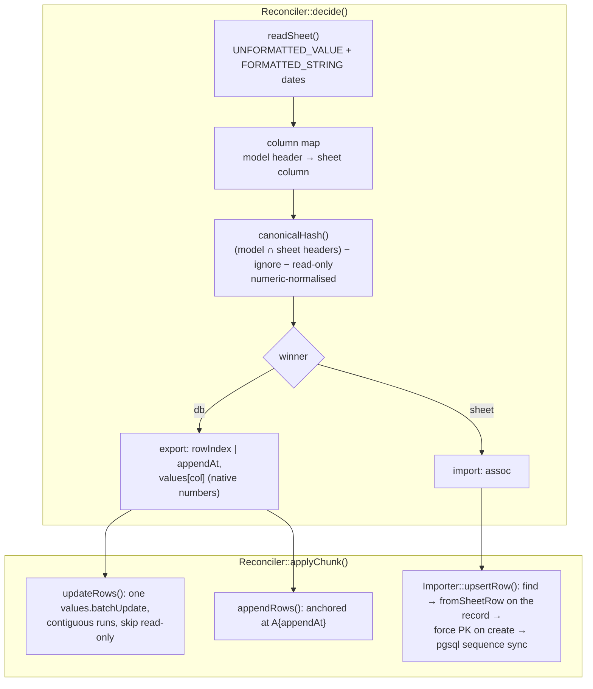

# Real-run fixes for bidirectional sync

**Date:** 2026-10-18 · **Found by:** first end-to-end run inside a real Laravel 13
app (Fitly / BetMate `BetTransaction`) against the live Google Sheets API and
PostgreSQL 18 (PGlite).

## 1. Why

The Phase 1–5 suite runs against `FakeGoogleClient` + SQLite + a permissive
fixture (`$guarded = []`, associative `toSheetRow()`), so it cannot see real API
semantics, PostgreSQL, guarded keys or soft deletes. Round 1 of the real run:
28 checks, 20 failed.

## 2. Findings

| # | Defect | Effect seen in the real run |
|---|---|---|
| B1 | `GoogleClient::setupServiceAccount()` only searched relative paths | absolute `GOOGLE_SERVICE_ACCOUNT_JSON_LOCATION` (the usual form) → "file not found" |
| B2 | Provider merged revolution's `config/google.php` from `base_path('vendor/…')` / `__DIR__/../vendor/…` | crash when the package is a path repo / submodule (and the whole test suite under testbench) |
| B3 | Positional `toSheetRow()` (a list, as in the README example) is read by header key in `Reconciler` | every DB row exported **empty**, every DB hash identical → DB changes invisible |
| B4 | Appends go through revolution's assoc→header ordering (`array_flip` collapses blank/duplicate headers) and `values.append` on the bare sheet name | Google "table detection" starts the row at column **X** when the header row has gaps; rows land shifted / compacted |
| B5 | Values are cast to strings and written `RAW` | numbers stored as **text** → `=SUM()` formulas / pivots read 0 |
| B6 | Reads use `FORMATTED_VALUE` | display formats (`1,500`, rounding) leak into hashes and imports |
| B7 | Sheet→DB create uses `updateOrCreate([pk => …])` | guarded `id` silently dropped → record gets a new id → re-created **every run** (duplication loop) |
| B8 | Soft-deleted records look "missing from DB" | resurrected as new records each run |
| B9 | `fromSheetRow()` is called on a fresh instance | cannot merge into existing attributes (e.g. JSON metadata keys lost) |
| B10 | In-place update rewrites the whole row from column A, one API call per row | formulas and sheet-only columns clobbered; rate-limit sleeps on big diffs |
| B11 | Reconcile into a header-less sheet appends data without a header row | first data row becomes the header on the next read |

## 3. Design of the fix

- **Row normalisation** (`DataTransformer::toAssoc()`): a list row is combined
  positionally with the model headers; blank headers are positions only.
- **Column map**: values are placed by *sheet* header position, so sheet-only
  columns and column order are respected; only mapped columns are written.
- **Read-only columns** (optional model method `syncReadOnlyColumns()`): never
  overwritten on an existing row (formulas), still written on append, excluded
  from the hash.
- **Native numbers**: `formatValue()` keeps `int`/`float`; `canonicalHash()`
  normalises numerics so `"11.00"`, `11` and `11.0` compare equal.
- **Anchored append**: `values.append` on the single cell `A{lastRow+1}`
  (probed: a full-width range or the bare sheet name re-triggers the column-X
  shift; a single-cell anchor appends after any rows a concurrent writer added).
  `decide()` pre-assigns `appendAt` per decision so queued chunks are
  order-independent.
- **Upsert by PK**: `Importer::upsertRow()` is shared by import and reconcile;
  creates keep the sheet's PK (`setAttribute`, not mass assignment) and, on
  PostgreSQL, the key sequence is moved past `MAX(pk)` so later inserts do not
  collide.
- **Soft deletes**: trashed keys are left alone by import and reconcile.
- **Header bootstrap**: an empty sheet gets the model headers before rows are
  appended.

## 4. Regression tests

One PHPUnit test per defect in `tests/Feature/RealRunRegressionTest.php`
(positional model fixture with a guarded key and soft deletes), plus the
existing suite adapted to the list-based writes. The end-to-end real-run
harness is published as a worked example in
[`docs/examples/real-run/`](../examples/real-run/README.md).
