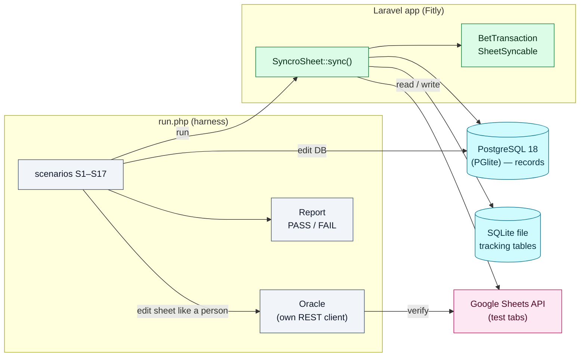

# Real run: a ledger synced both ways

***The end-to-end run that verified SyncroSheet's bidirectional sync against a real Laravel app, the live Google Sheets API and PostgreSQL. You can read it as a worked example, or adapt and run it as a harness.***

**Last updated:** 2026-10-18 · verified against [`7f9a6dc`](https://github.com/ultra-bugs/syncro-sheet/commit/7f9a6dc442f65ee59193c57a5a722fa2012ab8d5)

> [!NOTE]
> The test suite runs against a fake Google client and SQLite. This run
> covers what the suite cannot see: real API semantics (typed cells, append
> table detection, quota), PostgreSQL sequences, guarded keys, soft deletes,
> formulas, and people editing the sheet. Round 1 failed 20 of 28 checks.
> Every defect it found was fixed in the package, and all but one fix have a
> regression test (see [What the real run found](#7-what-the-real-run-found)).

## Table of Contents

- [1. Setup](#1-setup)
- [2. The sheet](#2-the-sheet)
- [3. The model contract](#3-the-model-contract)
- [4. Running the sync in the app](#4-running-the-sync-in-the-app)
- [5. The harness](#5-the-harness)
- [6. Scenarios](#6-scenarios)
- [7. What the real run found](#7-what-the-real-run-found)
- [8. Results](#8-results)
- [9. Normalisation to expect](#9-normalisation-to-expect)
- [10. Adapting it to your model](#10-adapting-it-to-your-model)

## 1. Setup

| Piece | What was used |
|---|---|
| App | Fitly: Laravel 13, modular monolith (`nwidart/laravel-modules`). Module **BetMate**, model `BetTransaction` (betting ledger: deposit/withdraw per account and day) |
| Package | `zuko/syncro-sheet` as a git submodule under `packages/zuko/syncro-sheet`, loaded through `wikimedia/composer-merge-plugin` |
| Records | PostgreSQL 18 through [PGlite](https://pglite.dev) (`pglite-server`, WASM build), PHP `pdo_pgsql` with emulated prepares |
| Tracking tables | the package's own SQLite file (`storage/syncro-sheet/tracking.sqlite`); one subset re-run with `SYNCRO_SHEET_DB_CONNECTION=pgsql` |
| Sheets | live Google Sheets API, service account with edit access; dedicated test tabs only (the production tab is read as seed data, never written) |
| Google library | `revolution/laravel-google-sheets` 7.2 |
| Credentials | rounds 1–8: app-wide `GOOGLE_SERVICE_ENABLED` + `GOOGLE_SERVICE_ACCOUNT_JSON_LOCATION`; round 9: those off, the module's service account handed to the package through `syncro-sheet.google.credentials` |



## 2. The sheet

The production ledger tab (`Thu chi`) is what people work in. One row per
entry, columns A..Y:

| Col | Header | Owned by | Notes |
|---|---|---|---|
| A | `Date` | sheet | day label, only on the first row of each day → **read-only** |
| B | `Site` | model | site code (blank = default site) |
| C | `Acc` | model | account label |
| D / E | `Dep` / `Out` | model | numbers |
| F | `Profit` | sheet | `=SUM(E{n},-D{n})` per row → **read-only** |
| G / H | `Note` / `Note2` | model | free text |
| I | `Date_Converted` | model | `Y-m-d H:i:s` |
| J..W | — | sheet | sheet-only columns, never written |
| X | *(blank header)* | model | **the id**: found by position, the header cell is empty |

Other rows on the tab: date separator rows (`13/10` in A, nothing else),
blank lines, and rows people type without an id.

## 3. The model contract

Condensed from `modules/BetMate/app/Models/BetTransaction.php`:

```php
use Zuko\SyncroSheet\Contracts\SheetSyncable;
use Zuko\SyncroSheet\Traits\InteractsWithSheet;

class BetTransaction extends Model implements SheetSyncable
{
    use InteractsWithSheet;
    use SoftDeletes;

    /** 0-based position => header text. Unlisted positions are not ours. */
    public const SHEET_COLUMNS = [
        0 => 'Date', 1 => 'Site', 2 => 'Acc', 3 => 'Dep', 4 => 'Out',
        5 => 'Profit', 6 => 'Note', 7 => 'Note2', 8 => 'Date_Converted', 23 => 'id',
    ];
    public const SHEET_ROW_WIDTH = 25; // A..Y

    public function getSheetIdentifier(): string { return config('betmate.google_sheets.spreadsheet_id'); }
    // Its own tab, never the ledger the observer push appends to (throws when unset).
    public function getSheetName(): string { return config('betmate.google_sheets.sync_sheet_name'); }

    // Positional row → the headers name each position ('' = not ours).
    public function defaultSheetHeaders(): array
    {
        return array_replace(array_fill(0, self::SHEET_ROW_WIDTH, ''), self::SHEET_COLUMNS);
    }

    public function getSheetKeyColumn(): string { return 'id'; }
    public function getSheetKeyColumnIndex(): int { return 23; }        // column X, header may be blank

    public function syncReadOnlyColumns(): array { return ['Date', 'Profit']; } // formula / day label
    public function syncHashIgnore(): array { return ['updated_at']; }

    public function toSheetRow(): array
    {
        $this->loadMissing(['account.site']);              // reuse batch eager loads
        $row = array_fill(0, self::SHEET_ROW_WIDTH, '');
        $row[0] = $this->processed_at?->format('d/m/Y') ?? '';
        $row[1] = $this->account->site->code ?? '';
        $row[2] = $this->account->label ?? '';
        $row[3] = (float) $this->dep ?: '';                 // native numbers: cells stay numeric
        $row[4] = (float) $this->out ?: '';
        $row[5] = (float) $this->profit ?: '';
        $row[6] = $this->metadata['note'] ?? '';
        $row[7] = $this->metadata['note2'] ?? '';
        $row[8] = $this->processed_at?->format('Y-m-d H:i:s') ?? '';
        $row[23] = $this->id;

        return $row;
    }

    // Runs on the target record: merges into the metadata it already holds.
    public function fromSheetRow(array $row): array
    {
        $attributes = [
            'dep' => $this->parseSheetAmount($row['Dep'] ?? null),
            'out' => $this->parseSheetAmount($row['Out'] ?? null),
            'metadata' => array_merge($this->metadata ?? [], [
                'note' => $row['Note'] ?? null,
                'note2' => $row['Note2'] ?? null,
            ]),
        ];
        if (($processedAt = $this->parseSheetDate($row['Date_Converted'] ?? null, $row['Date'] ?? null)) !== null) {
            $attributes['processed_at'] = $processedAt;
        }
        if (($accountId = $this->resolveSheetAccountId($row)) !== null) {
            $attributes['account_id'] = $accountId;      // Site + Acc → account (repository lookup)
        }

        return $attributes;
    }

    // Import gate for rows without an id: separators, totals, blank lines and
    // unknown accounts never become records.
    public function shouldImportSheetRow(array $row): bool
    {
        $hasAmount = (float) $this->parseSheetAmount($row['Dep'] ?? null) > 0
            || (float) $this->parseSheetAmount($row['Out'] ?? null) > 0;

        return $hasAmount && $this->resolveSheetAccountId($row) !== null;
    }
}
```

What each piece buys:

- **Positional row + `defaultSheetHeaders()`**: the row keeps the sheet's
  layout, and `''` positions (J..W) are never written.
- **`getSheetKeyColumnIndex() = 23`**: the id is read from and written to
  column X even though `X1` is blank on the production tab.
- **`syncReadOnlyColumns()`**: `Profit` formulas and day labels are written
  when a row is appended, never overwritten afterwards, and ignored by change
  detection.
- **`shouldImportSheetRow()`**: decides which rows typed on the sheet become
  records. Without it, every date separator would be offered as a record.
- **`fromSheetRow()` on the record itself**: a sheet edit of `Note` keeps the
  record's other `metadata` keys (S4).
- **Native numbers**: values are written `RAW`, so `Dep` / `Out` stay numeric
  and `=SUM()` / pivots keep working (S1).

The model does not override `sheetTransformer()`: the shared
`DataTransformer` handles every value.

## 4. Running the sync in the app

```php
use Zuko\SyncroSheet\Facades\SyncroSheet;

SyncroSheet::sync(BetTransaction::class);        // two-way reconcile
SyncroSheet::importFull(BetTransaction::class);  // sheet → DB only
```

```bash
php artisan sheet:sync "Zuko\Fitly\BetMate\Models\BetTransaction" --direction=both
```

The model syncs its own tab (`BETMATE_GOOGLE_SHEETS_SYNC_SHEET_NAME`, no
default), never the ledger tab the app's observer push appends to: that tab
holds raw entries, not one row per record. Left unset, the panel actions are
disabled with the reason and a run fails with it.

In the admin panel (Filament), a "Google Sheet" action group on the
transactions table dispatches a queued job (`ShouldBeUnique`, one run at a
time) that calls the methods above. The page shows the run history from
`sync_states` and a "Synced with sheet" filter built from `sync_snapshots`.
The tracking tables may live on the package's own SQLite file, so the filter
loads record ids from that connection and passes them to `whereKey()`; it
never joins across the two databases.

## 5. The harness

Files next to this README. They are not autoloaded and CI does not run them.

| File | Role |
|---|---|
| [`run.php`](run.php) | Seeds the DB, recreates the test tab, runs the scenarios, exits non-zero on a failure |
| [`lib.php`](lib.php) | `boot()` (with safety guards), PGlite patch, `Oracle`, `Report` |
| [`sheets-rest.php`](sheets-rest.php) | Minimal REST client for the Sheets API (service-account JWT, waits out a 429) |
| [`ledger-tab.php`](ledger-tab.php) | Builds a tab shaped like the production ledger (S16, S17) |

Principles:

- **Independent oracle.** The harness reads and edits the sheet through its
  own REST client, never through the package under test, so a package bug
  cannot hide itself.
- **Edits like a person.** Sheet edits use `USER_ENTERED`, as if typed in the
  UI; formulas are real formulas.
- **Each scenario ends with an idempotency check.** The next sync must
  process 0 records. Most real-run bugs showed up as "processed 100 again".
- **Guards.**
  - It refuses to run unless `RT_SCRATCH_DB=1`, because it truncates the
    BetMate and tracking tables.
  - It refuses unless the model is pointed at the test tab.
  - It refuses if the app's own observer push to the sheet is enabled, so
    there is never a second writer on the tab.
  - It never recreates the source tab.

Environment:

| Variable | Default | Meaning |
|---|---|---|
| `RT_APP` | cwd | path of the Laravel app |
| `RT_SPREADSHEET` | — (required) | spreadsheet holding the test tabs |
| `RT_SERVICE_ACCOUNT` | — (required) | service-account JSON with edit access |
| `RT_TAB` | `syncro_rt` | main test tab; `_x`, `_ledger`, `_scale` and `RT2026` tabs are created next to it |
| `RT_SOURCE_TAB` | `Thu chi` | tab the seed data is read from (read only) |
| `RT_SEED_ROWS` / `RT_LEDGER_ROWS` | `5100:5242` / `5200:5242` | source rows used by `setup` / S16 |
| `RT_PGLITE` | — | `1` = emulated prepares on every `pgsql` connection |
| `RT_SCRATCH_DB` | — | `1` = confirm the database is throwaway |

```bash
# PostgreSQL 18 in WASM, no server install (npm i -g @electric-sql/pglite-socket)
pglite-server --db=./pgdata --port=5433 --max-connections=32 &

# the app's .env points DB_* at 127.0.0.1:5433; then, from the app root:
php artisan migrate

RT_APP=$PWD RT_SPREADSHEET=<spreadsheet-id> RT_SERVICE_ACCOUNT=/path/to/sa.json \
RT_TAB=syncro_rt RT_PGLITE=1 RT_SCRATCH_DB=1 \
php packages/zuko/syncro-sheet/docs/examples/real-run/run.php            # setup + all
php packages/zuko/syncro-sheet/docs/examples/real-run/run.php S3 S4      # selected scenarios
```

PGlite notes: `pglite-socket` drops the connection after an error in the
extended query protocol (hence `RT_PGLITE=1`). Its default of one
connection is too low for a Laravel app with several connections, so start
it with `--max-connections=32`.

## 6. Scenarios

`setup` aggregates `RT_SEED_ROWS` of the source tab into one transaction per
account and day: 3 sites, 46 accounts, 100 records. It then recreates the
test tab with the model's header row.

| # | What happens | What is checked |
|---|---|---|
| S1 | First two-way sync onto an empty tab | 100 processed; one row per record; a baseline per record; `Dep` is a numeric cell; `Date_Converted` round-trips |
| S2 | Sync again, nothing changed | 0 processed; sheet byte-identical |
| S3 | Edit `dep` + note in the DB | 1 processed; updated **in place** (same row, no append); next run 0 |
| S4 | Edit `Out` + `Note` on the sheet | DB updated; other `metadata` keys kept; account, date, dep untouched; next run 0 |
| S5 | Same record edited on both sides | `source_of_truth = db` → DB wins; switched to `sheet` → sheet wins; next run 0 |
| S6 | New record in the DB | appended exactly once; next run 0 |
| S7 | Row typed on the sheet **with** an unknown id, then one **without** an id | created with that id (guarded key kept); no duplication loop; PostgreSQL sequence moved past it (next insert = 900001); row without id created once and its id written back into X of that row |
| S8 | Soft-delete a record | not resurrected, stays trashed, next run 0 |
| S9 | Write a `Profit` formula and a sheet-only cell (K), then edit the record | formula and K preserved |
| S10 | Export-only `fullSync()` to a fresh tab, edit a cell, `importFull()` | all live records written with the model header; the edit imported |
| S11 | `scheduler.driver = queue` (sync queue), DB edit | queued decide/apply propagated it; inline run afterwards 0 |
| S12 | `php artisan sheet:sync … --direction=both` | exit code 0 |
| S13 | Tab named `RT2026` (also a valid A1 reference) | the tab is addressed, not cell RT2026 |
| S16 | Tab shaped like the production ledger (43 raw rows: blank `X1`, date separators, no ids, `Profit` formulas) | one record per transaction row (37); each row gets its own id in X matching the record; separators untouched; `Profit` formulas and day labels untouched; next run 0 |
| S17 | A person types a row; a row is inserted above it **between** `decide()` and `applyChunk()` | nothing created, no id written to the wrong row; next run creates it once with the id on the shifted row; then stable |
| S14 | Scale: the whole source tab aggregated (3 782 records) to its own tab | exported once; no-op 0; one edit → 1 |

S16 runs `Reconciler::decide()` and `applyChunk()` separately, the same way
the queue driver does.

## 7. What the real run found

Each defect in this table is fixed in the package. Every fix has a
regression test in `tests/Feature/` except the throttle-window fix. Design
notes are in the linked plan docs.

| Seen in | Defect | Fix |
|---|---|---|
| S1–S3 | A positional `toSheetRow()` was read by header key → rows exported empty, DB changes invisible | rows normalised positionally against the headers ([real-run fixes](../../agent-plans/20261018_real-run-fixes.md) B3) |
| S1, S6 | `values.append` table detection started rows at column X when the header row has gaps | append anchored on the single cell `A{lastRow+1}` (B4) |
| S1 | Values written as strings → numbers stored as text | native `int`/`float`, `RAW` writes; numerics compared by value (B5, B6) |
| S7 | Guarded `id` dropped on create → new id every run (duplication loop) | key forced on create; PostgreSQL sequence synced (B7) |
| S8 | Soft-deleted records resurrected | trashed keys left alone (B8) |
| S4 | `fromSheetRow()` on a fresh instance lost JSON keys | runs on the target record (B9) |
| S9 | In-place update rewrote the row from A, one call per row | sparse `values.batchUpdate`, read-only columns (B10) |
| boot | Service-account path / revolution config path broke as a submodule | absolute paths; config located via reflection (B1, B2) |
| round 1 (S13 added to pin it) | Tab names like `Oct25` / `RT2026` parsed as cell references | sheet names always quoted (6dcc617) |
| S16 | The id column had no header → key not found; typed rows skipped | `getSheetKeyColumnIndex()`, rows without a key created + key written back ([key by index](../../agent-plans/20261018_sheet-key-column-index.md)) |
| S17 | (design) a row moved between plan and apply could receive a wrong id | rows re-read before the write-back; creates + write-back in one DB transaction |
| S17, round 5 | A 429 failed the run: default throttle 100/min > Google's 60/min/user | default 60/min, 429/5xx retried with backoff; throttle waited on the newest instead of the oldest request |
| round 7 | "not synced in 7 days" export filter compared `record_id` with `sync_entries.id` | qualified model key; works across connections ([model hooks + tracking](../../agent-plans/20261018_model-hooks-and-tracking-connection.md)) |
| copy of the production tab, after round 9 | First run on 5 548 rows: re-reading the 4 102 created rows in one `values.batchGet` → 413 | rows re-read in spans, ≤ 100 per request ([production tab rehearsal](../../agent-plans/20261018_production-tab-rehearsal.md)) |
| copy of the production tab, after round 9 | The create write-back rewrote whole rows with the normalised record (4 206 cells: formulas → values, `0` → blank, milliseconds, trailing spaces, a default site) | only the key is written; a baseline per side (`sheet_hash`) |
| copy of the production tab, after round 10 | An app edit rewrote every writable cell of its row: `=50+20` in `Dep` became `70`, `Date_Converted` lost `.000` | in-place exports write only cells whose value changed; the model writes `Date_Converted` as the ledger does (`Y-m-d H:i:s.v`) |
| admin panel, after round 8 | Without `GOOGLE_SERVICE_ENABLED` the client called a missing `TokenManager::getToken()`; the `\Error` escaped `catch (\Exception)`, and failed full / import / two-way runs were never marked failed → run stuck at `running`, 0 records | `\Throwable` caught, run always marked failed, dead-worker runs ended by the next run, clear "no credentials" error, `syncro-sheet.google.credentials` ([failed runs + credentials](../../agent-plans/20261018_failed-runs-and-credentials.md)) |

## 8. Results

| Round | Package | Checks | Failed |
|---|---|---|---|
| 1 | `caaa20e` (as first shipped) | 28 | 20 |
| 4 | `6dcc617` real-run fixes | 40 | 1 |
| 6 | `a79146e` key by index, rows typed on the sheet | 48 | 1 |
| 7 | `7f9a6dc` model hooks, tracking tables on SQLite | 49 | 1 |
| 8 | `7f9a6dc`, this published harness | 48 | 0 |
| 9 | `5db9bd7` failed runs + package credentials; no `GOOGLE_SERVICE_*` in the environment | 48 | 0 |
| 10 | `638897e` per-side baselines, key-only write-back, `readRows()` in spans | 48 | 0 |
| 11 | `a046c9e` cell-level in-place exports, preview | 48 | 0 |

In rounds 4–7 the single failure was an app check (S15). It exercised the
app's own legacy observer push, which writes invalid tracking rows. That
check is not part of the package, so the published harness leaves it out.
Round 7 also re-ran a subset with `SYNCRO_SHEET_DB_CONNECTION=pgsql`: 18/18.

Timings on PGlite (WASM PostgreSQL, so slower than a real server), live API:

| Run | Records | Round 7 | Round 8 | Round 9 | Round 10 | Round 11 |
|---|---|---|---|---|---|---|
| initial sync (S1) | 100 | 1.3 s | 0.7 s | 0.8 s | 0.8 s | 0.7 s |
| no-op / single edit (S2–S6) | 100 | 0.2–0.5 s | 0.2–0.5 s | 0.2–0.6 s | 0.4–0.6 s | 0.3–0.6 s |
| ledger tab, 37 rows created + ids written back (S16) | 43 rows | 1.8 s | 1.8 s | 4.3 s | 1.8 s | 1.7 s |
| scale initial (S14) | 3 782 | 4.1 s | 3.8 s | 3.3 s | 3.3 s | 3.2 s |
| scale no-op | 3 782 | 1.7 s | 1.6 s | 1.5 s | 1.6 s | 1.4 s |
| scale single edit | 3 782 | 2.3 s | 1.6 s | 1.6 s | 2.0 s | 1.6 s |

**Rehearsal on a copy of the production tab** (after round 11, `duplicateSheet`
of the 5 548-row ledger: values, formulas, formatting; DB emptied, the sheet as
the full history):

| | Result |
|---|---|
| preview (`SyncManager::preview()`) | `create 4102, append 0`; with the old records still in the DB: `create 4102, append 3782` (would duplicate the history) |
| first run | 4 102 records created in 30 s on PGlite (160 s before the app memoised account lookups per run) |
| cells changed on the copy | 4 102, all in X (the ids) |
| rows left without an id | 1 033 day labels / totals / blanks, 135 without an amount, 50 without a valid date, 227 whose account is unknown |
| second run | 0 processed, 2.3 s |

Then a few days of use on the copy:

| Change | Run | Cells written on the sheet |
|---|---|---|
| a person edits `Dep` | 1 imported | none |
| a person types a new row (no id) | 1 created | its id (X) |
| the app edits a record whose `Dep` is `=50+20` | 1 exported | only the edited `Note2` cell; the formula stays |
| nothing | 0 | none |

Round 9 then drove the admin-panel job (`RunTransactionSheetSyncJob`) three
times on the test tab: with the module's credentials it completed, and a run
left `running` 12 minutes earlier was marked `Abandoned`; with no two-way tab,
and with no credentials, the run failed with the reason instead of hanging.

Round 7, abridged:

```text
== S1
    sync(initial): processed=100 status=completed 1.3s
  [PASS] S1 — processed == seeded records
  [PASS] S1 — one sheet row per record
  [PASS] S1 — baseline seeded for every record
  [PASS] S1 — Dep cell is a number (formulas/pivots can sum it)
  [PASS] S1 — Date_Converted round-trips
== S2
    sync(no-op): processed=0 status=completed 0.3s
  [PASS] S2 — idempotent: 0 processed
  [PASS] S2 — sheet untouched
…
== S16
    sync(thu-chi-like, rows without id): processed=37 status=completed 1.8s
  [PASS] S16 — created one record per transaction row (37)
  [PASS] S16 — every transaction row got its own id in X, matching the record
  [PASS] S16 — separator rows untouched (no id)
  [PASS] S16 — read-only cells untouched: Profit formulas (F) and day labels (A)
    cells rewritten by the write-back (normalisation): 37 e.g. [[2,8,"2026-10-11 01:29:20.092","2026-10-11 01:29:20"], …]
    sync(thu-chi-like #2): processed=0 status=completed 0.2s
  [PASS] S16 — next run stable (no new records, nothing processed)
== S17
  [PASS] S17 — moved row: nothing created, no id written to a wrong row
    sync(after the insert): processed=1 status=completed 0.6s
  [PASS] S17 — next run creates it once, id on the right (shifted) row
    sync(after the insert #2): processed=0 status=completed 0.2s
  [PASS] S17 — stable afterwards
== S14
    sync(scale initial (3782 records)): processed=3782 status=completed 4.1s
    sync(scale no-op): processed=0 status=completed 1.7s
    sync(scale one edit): processed=1 status=completed 2.3s
  [PASS] S14 — scale: 3782 records exported once, no-op, single edit
```

## 9. Normalisation to expect

- **Precision.** `Date_Converted` typed with milliseconds (`…20.092`) is
  stored as `…20`, because the column is `timestamp(0)`. The sheet keeps what
  was typed: a row created from the sheet gets only its id (S16, rounds 1–9:
  37 cells rewritten; round 10: 0), and each side is compared with its own
  baseline, so the difference is not a change.
- **Formulas outside read-only columns** are replaced only when the DB
  changes that cell's value. An app edit writes only the cells it changes
  (round 11). List every formula column in `syncReadOnlyColumns()` anyway.
- **First sync of an existing tab.** Rows that already agree with the DB are
  only baselined. Rows that differ are resolved by the source of truth.
- **One writer.** Do not run another process that writes the same tab (here,
  the app's legacy observer push) at the same time as the sync.
- **Quota.** 60 requests/min/user is shared with anything else using the
  same service account, the harness included. The package throttles and
  retries, so expect slower runs, not failures.

## 10. Adapting it to your model

1. Replace the imports of the BetMate models in `run.php` with yours, and
   `SHEET_NAME_CONFIG` with the config key your model reads its tab name
   from.
2. Rewrite `setup()` to seed your table and recreate the tab with your
   `defaultSheetHeaders()`. Rewrite the guard in `boot()` that checks your
   app's own sheet writer.
3. Adjust the column letters in S3–S9 (`D`/`E`/`G` = edited columns, `F` =
   a read-only formula, `K` = a sheet-only column, `X` = the key) and the
   expected count in S16.
4. Keep the shape of every scenario: change one side, sync, check both
   sides through the oracle, then sync again and expect 0.
